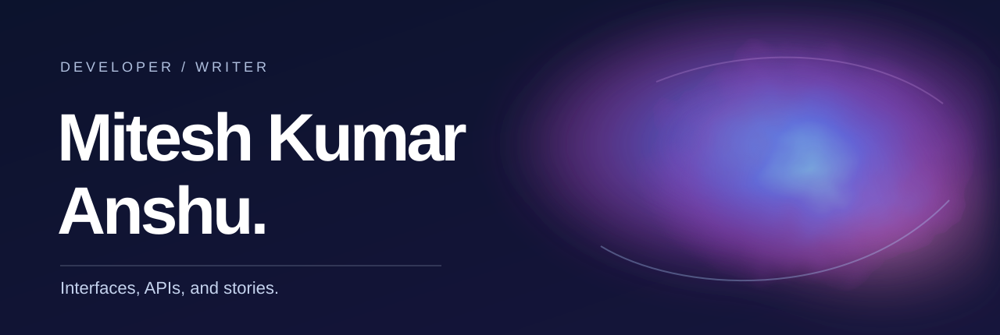
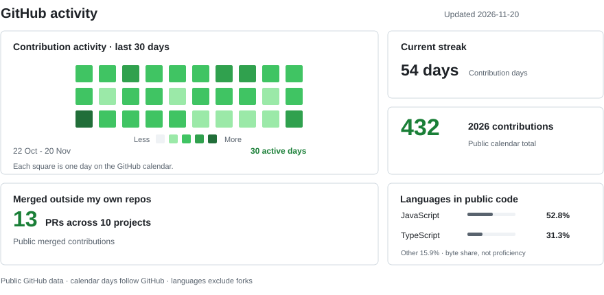

  
  
  
  
  
  
  
  

<picture>
  <source media="(prefers-color-scheme: dark)" srcset="./assets/github-activity-dark.svg">
  <source media="(prefers-color-scheme: light)" srcset="./assets/github-activity-light.svg">
  
</picture>

Open to full-time roles in Delhi NCR (or remote).

### Merged open-source work

<!-- merged-prs:start -->
[freeCodeCamp #70721](https://github.com/freeCodeCamp/freeCodeCamp/pull/70721) · [PdfZero #9](https://github.com/bevinkatti/PdfZero/pull/9) · [career-ops #4728](https://github.com/career-ops-hq/career-ops/pull/4728), [career-ops #4807](https://github.com/career-ops-hq/career-ops/pull/4807) · [rolecraft #360](https://github.com/rolecraft-sh/rolecraft/pull/360), [rolecraft #365](https://github.com/rolecraft-sh/rolecraft/pull/365) · [platypus #1149](https://github.com/willdady/platypus/pull/1149) · [kinshow #432](https://github.com/kiinshuk/kinshow/pull/432) · [activist #2449](https://github.com/activist-org/activist/pull/2449) · [Communities #735](https://github.com/FOSSUChennai/Communities/pull/735) · [neo #20756](https://github.com/neomjs/neo/pull/20756)
<!-- merged-prs:end -->

I build web apps, and I write stories. The work is different, but I keep coming back to the same question: what belongs here, and what can I leave out?

My usual stack is **React, Node.js, Express and PostgreSQL**. I also write Java. I care about the small decisions between the screen and the database - the parts that either make a product feel easy or get in someone's way.

### The work

**01 / [CircuLib](https://github.com/miteshanshu/Library-Management-System---RBAC)**  
A library system built around the people who use it: students, librarians and admins. React, Express and PostgreSQL; separate workflows for loans, returns and overdue items. Open source under the MIT license.
[Live demo](https://library-management-system-rbac.vercel.app/) · [Code](https://github.com/miteshanshu/Library-Management-System---RBAC). The server sleeps when idle, so the first login can take around 40 seconds.

**02 / [Matbhed](https://matbhed.onrender.com)**  
An anonymous live voice debate app. Two people pick opposite sides of a motion and get 7 minutes on open mics, with up to 8 listeners in the room. React, Node, Socket.IO and LiveKit. No sign-up.
[Live app](https://matbhed.onrender.com)

**03 / [WalletWing](https://github.com/miteshanshu/WalletWing)**  
A React storefront with search, filters, cart, wishlist and product comparison, plus Firebase sign-in. Checkout is a demo, it never takes a real payment.  
[Live demo](https://wallet-wing.vercel.app) · [Code](https://github.com/miteshanshu/WalletWing)

**04 / [Shringaar Studio](https://shringaar-studio-site.vercel.app/)**  
A photo-led React site for a nail studio. I wanted the studio's actual work to carry the page, not a wall of generic salon copy. This is a concept for studio review, not its approved website.

### Away from the editor

I write fiction as **ANSHU**. *Sukoon* is my debut novel, and *Teen Kinare*, a Hindi novella, is in progress. It gives me another way to think about pacing and what to leave out.

If something here speaks to you, [email me](mailto:miteshanshu1@gmail.com), find me on [LinkedIn](https://linkedin.com/in/miteshanshu) or [X](https://x.com/miteshanshu_dev), or read my [Substack](https://miteshanshu.substack.com). If my open source work has been useful to you, you can [sponsor it here](https://github.com/sponsors/miteshanshu).
